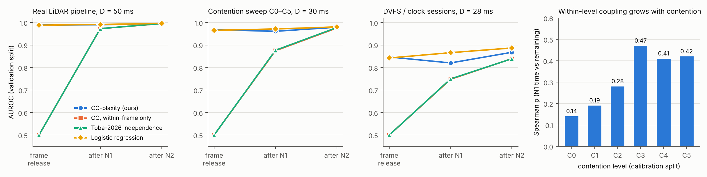
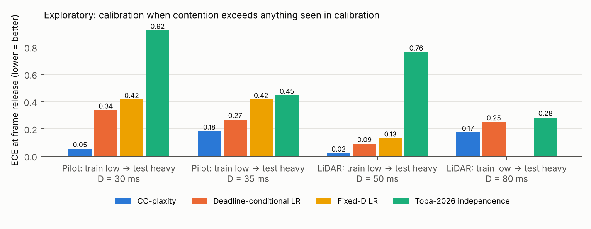
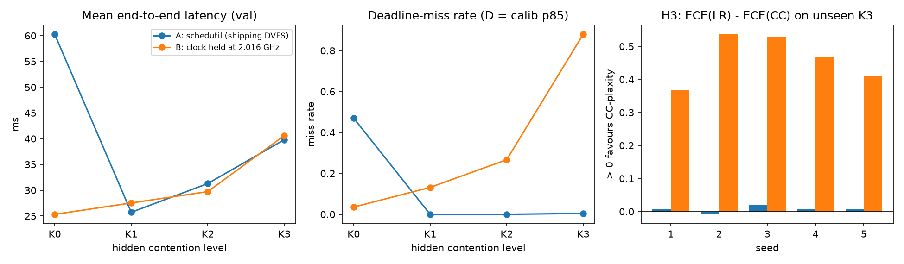
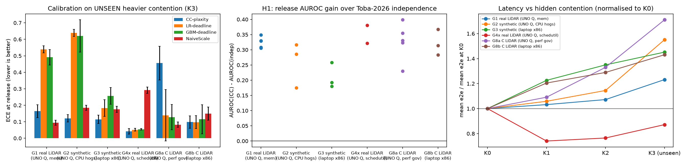
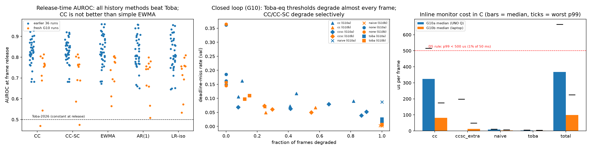
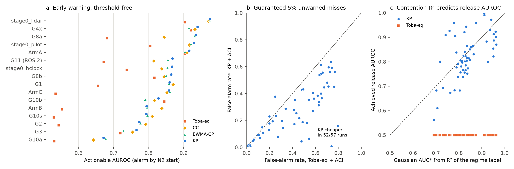

# Contention-Coupled Plaxity: what Toba-2026 early detection is missing

Date: 6 Nov 2026. Data: existing traces in `D:\RTKK` (real-LiDAR replay, contention sweep C0–C5, DVFS/clock sessions)
**plus a new confirmatory run on the Arduino UNO Q: 2 arms × 5 seeds × 5,000 frames (50,000 frames, ~84 min of board time).**
Board results are in the section "UNO Q confirmation" below, plus a **pre-registered generalization study** (13 more runs:
real nuScenes LiDAR, CPU contention, a second x86 platform, gradient-boosting and naive-scaling baselines), in the section "Generalization study".

## One-paragraph answer

Toba, Baruah & Azumi (TECS 2026) detect deadline misses early using probabilistic laxity (plaxity) computed *per frame*
under *node independence*. Their own paper names both as limitations (§2.2: independence; §7: "lightweight online
monitoring … distribution updates at runtime"). Our traces show both assumptions break in a specific, exploitable way:
**contention is a shared, persistent state.** It slows every node of a frame together, and it carries over from one
frame to the next. We model it with one latent slowdown factor per frame. The factor is tracked across frames by a
sticky HMM and updated within the frame by the nodes that have completed. It plugs straight into Toba's
convolution/lookup machinery. We call this **CC-plaxity**. Results:

1. **Lead time.** Per-frame plaxity has zero information at frame release (AUROC = 0.50 by construction). It therefore
   alarms only around or after the deadline (mean lead time −5.5 to +2.7 ms in 6 of 7 settings; in the 7th it alarms on every frame). CC-plaxity
   at frame release reaches AUROC 0.81–0.998 and alarms with 6–47 ms of lead time at 1–7% FPR, using Toba's own
   *untuned* probability thresholds.
2. **Calibration.** Even with no history, the coupling term makes plaxity probabilities calibrated in all 14
   dataset × deadline × checkpoint cases (ECE 1.4–28× lower than independence).
3. **Honest limit.** At a fixed, known deadline and in-distribution contention, a 3-feature logistic regression
   matches CC-plaxity on AUROC. The *information* (previous-frame state) is the main win, not the model class.
4. **Where the structure pays (exploratory).** When contention exceeds anything seen in calibration, CC-plaxity stays
   calibrated: ECE 0.02–0.18 vs 0.09–0.42 for learned models and 0.28–0.92 for independence plaxity. This is the claim
   the board experiment is designed to confirm or kill.

## Why this is new relative to the folder's earlier work

The earlier bundles tested ACI, CUSUM, EVT, α-spending, super-nodes, and a discrete regime classifier (rolling median of
past frames → nearest centroid → per-regime Toba). Their central negative result was "early checkpoints give lead
time but no information." That result holds for **per-frame** detectors. The gap is information that arrives before
the frame starts. Specifically:

- **Mechanism, not just a detector.** A one-factor model (`log d_i = β_i·σ + η_i`) explains both the Simpson's-paradox
  correlation (pooled ρ 0.88 vs within-regime 0.22–0.54) and the finding that coupling **grows with contention**
  (C0→C5: ρ 0.14→0.42). The independence assumption fails *more* exactly when misses are likely.
- **Continuous, not discrete regimes.** There are no centroids and no regime labels. The posterior over σ falls back
  to the population prior when history is uninformative.
- **Fits Toba's framework.** Offline: a table of P(R > L | σ) per checkpoint (121 σ-points × idle samples). Online: a
  121-element posterior update and a dot product. Toba's probability thresholds keep their meaning; the
  independence version does not.
- **One theoretical observation reviewers will like.** At any single checkpoint, a plaxity score that depends only on
  elapsed time is monotone in elapsed time. So *no* choice of PMFs or thresholds can improve its ranking. Gains must
  come from extra state.

## Results (validation splits; test split is spent and was not used, even as history)

### Discrimination by checkpoint (AUROC)

| Dataset, D | Method | release | after N1 | after N2 |
|---|---|---:|---:|---:|
| LiDAR, 50 ms | CC-plaxity | **0.989** | 0.990 | 0.995 |
| | Toba-2026 independence | 0.500 | 0.973 | 0.996 |
| | Logistic regression | 0.988 | 0.991 | 0.996 |
| Pilot C0–C5, 30 ms | CC-plaxity | **0.968** | 0.961 | 0.979 |
| | Toba-2026 independence | 0.500 | 0.877 | 0.977 |
| | Logistic regression | 0.966 | 0.971 | 0.981 |
| Clock sessions, 28 ms | CC-plaxity | **0.847** | 0.820 | 0.868 |
| | Toba-2026 independence | 0.500 | 0.749 | 0.839 |
| | Logistic regression | 0.842 | 0.866 | 0.887 |

CC-plaxity vs independence, AUROC difference at release: +0.31 to +0.50. Block-bootstrap 95% CIs exclude 0 in all 7
settings (`results/cc_bootstrap_diffs.csv`). Against logistic regression, release-time AUROC CIs include 0 in all 7
settings. After N1, LR is ahead by up to 0.045, significantly so in 5/7 settings.



### End-to-end early detection with Toba's untuned variable thresholds (0.50 → 0.99 across checkpoints)

Recall / FPR / mean lead time before the deadline (true positives). Negative lead means the alarm fired after the deadline.

| Dataset, D | CC-plaxity | Toba-2026 independence | Logistic regression |
|---|---|---|---|
| LiDAR, 50 ms | **97.8% / 1.3% / 47.0 ms** | 95.8% / 0.0% / −3.3 ms | 93.8% / 2.0% / 49.7 ms |
| LiDAR, 80 ms | **84.2% / 3.2% / 35.7 ms** | 57.2% / 0.0% / −5.5 ms | 62.5% / 6.9% / 72.4 ms |
| Pilot, 30 ms | **97.0% / 2.6% / 27.7 ms** | 89.4% / 0.0% / 2.7 ms | 93.2% / 9.6% / 29.7 ms |
| Pilot, 35 ms | **85.7% / 4.5% / 12.9 ms** | 55.8% / 0.0% / −1.8 ms | 58.1% / 10.9% / 30.0 ms |
| Clock, 28 ms | **97.2% / 6.6% / 12.0 ms** | 93.4% / 0.0% / −2.9 ms | 70.7% / 12.1% / 21.8 ms |
| Clock, 32 ms | **93.3% / 3.4% / 6.4 ms** | 87.3% / 0.0% / −1.8 ms | 20.8% / 2.0% / 20.4 ms |
| LiDAR, 35 ms | 99.8% / 1.1% / 34.9 ms | 100% / **100%** / 35.0 ms | 99.7% / 1.3% / 35.0 ms |

Fixed probability thresholds only work if the probabilities mean what they say. CC-plaxity gives the best recall/FPR
balance in 6 of 7 settings without per-deployment tuning. When LR beats it on lead time, LR pays with lower recall or
higher FPR. With thresholds re-tuned to 90% recall on calibration (`results/cc_pipeline.csv`), LR alarms earlier than
CC-plaxity. A single uniform threshold is the wrong operating rule for a calibrated monitor. Report both.

### Exploratory: unseen, heavier contention (train on C0–C2 / idle+moderate, test on C3–C5 / heavy+shift)



AUROC is similar across methods (LR slightly higher in 3 of 4 cases). Calibration is where CC-plaxity separates, because
the multiplicative factor extrapolates and the learned intercepts do not. This was designed after the primary results,
so it is a hypothesis, not a result. Confirming it is the board's job.

## Corrections to my own first pass (kept on record)

- I originally expected within-frame coupling to improve discrimination at checkpoint 1. It cannot (see the
  monotonicity argument above). Measured: CC-within and independence plaxity have identical AUROC (Spearman 0.99–1.00).
  The gain is calibration only. The board protocol's H2 was rewritten as a Brier claim *before* collecting board data.
- The existing UNO Q monitor traces show no persistence (lag-1 ρ ≈ 0) and no cross-branch coupling (ρ = 0.06). That
  benchmark has a workload step, not shared contention. This is a **boundary condition**: CC-plaxity should give no
  gain on workloads without a shared resource state. Say so in the paper.

## UNO Q confirmation (run 6 Nov 2026; frozen script and frozen analysis code, both unchanged)

Board: Arduino UNO Q (Qualcomm QRB2210, 4× Cortex-A53 @ ≤2.016 GHz, Debian, kernel 7.0). Script md5
`256e15d85cb8651d01eae4562f9591d7`. Each seed: 3,000 calibration frames (hidden K ∈ {0,1,2}) and 2,000 validation frames
(K ∈ {0,1,2,3}; K = 3 never seen in calibration). Deadline D = calibration p85, fixed before validation scoring.

**Arm A, board as shipped (`schedutil` DVFS governor).** A confound was found *during* the run (protocol deviation 4).
With no contention, the pipeline's ~30% duty cycle lets the governor lower the clock, so **K0 is the slowest state**
(60.3 ms mean e2e; node 1 6.9 ms vs 2.5 ms at K1). 47% of K0 frames miss; K1–K3 almost never miss (≤0.4%).

**Arm B, clock held at 2.016 GHz** (four `SCHED_IDLE` spinners, one per core, no root; deviation 5). All 502 frequency
samples (every 5 s, 4 cores) read 2,016,000 kHz. Slowdown now rises with K as designed: e2e 25.3 / 27.5 / 29.7 / 40.6 ms,
miss rate 3.5% / 13.2% / 26.7% / **88.0%** at K0 / K1 / K2 / unseen K3.

| Pre-registered test | Arm A (shipping DVFS) | Arm B (clock held) |
|---|---|---|
| **H1** release AUROC, CC − independence, CI > 0 | **5/5** (+0.37 to +0.43) | **5/5** (+0.27 to +0.34) |
| **H2** checkpoint-1 Brier, CC-within < independence, CI < 0 | 5/5 (−0.013 to −0.056) | **3/5** (−0.033 to +0.005) |
| **H3** unseen-K3 ECE at release, CC < deadline-conditional LR | 4/5 (*uninformative: 0–3 K3 misses per seed*) | **5/5**: 0.115–0.232 vs 0.599–0.698 |
| Kill rule (H3 fails on ≥ 3 seeds) | not triggered | not triggered |



What the board establishes:
1. **H3 is confirmed on hardware** (Arm B, the clean test). Under contention heavier than anything in calibration,
   CC-plaxity's miss probabilities stay usable (ECE 0.12–0.23), while the learned LR's collapse (0.60–0.70): **2.6–5.6×
   lower calibration error on every seed**. On the laptop data this claim was exploratory; on the board it is pre-registered and confirmed.
2. **H1 replicates in both arms.** Release-time information from the previous frame gives +0.27 to +0.43 AUROC over
   Toba-2026 independence plaxity (0.50 by construction) on 10 of 10 board runs.
3. **H2 is weak.** With a stable clock, within-frame coupling improves Brier score on only 3/5 seeds, and the effect is
   small. In Arm A it passes 5/5, but there the "coupling" partly reflects the DVFS state. Report H2 as mixed; do not make it a contribution.
4. **New, unplanned finding (Arm A):** on a power-managed SoC, *background load can speed a periodic pipeline up*.
   The hidden slowdown state is **non-monotone** in contention, because the frequency governor and contention act in
   opposite directions. Any method that equates "more interference" with "slower" (idle-profiled PMFs, contention-level
   regimes, WCET inflation factors) gets the sign wrong in the low-load regime. Toba's PMFs profiled on an idle board are
   from the *slow* state on this hardware. A latent-slowdown model needs no sign assumption, and H1 still passes 5/5, but its
   K0 reference regime is misplaced and H3 cannot be tested there. This is exploratory (not pre-registered) and is the most
   distinctive hardware observation in the study.

Raw data: `board_armA_schedutil/`, `board_armB_spin/` (with `freq_log.txt.log`, `run_log.txt.log`, `spin.py`, `armB2.sh`).
Per-seed metrics: `results_armA_schedutil/`, `results_armB_spin/`. Two-arm tables: `results/board_two_arm_summary.csv`,
`results/board_miss_by_K.csv` (from `board_summary.py`).

Limitations to state: one board and one synthetic (LiDAR-shaped) workload; Arm B holds the clock with idle-priority spinners
rather than the `performance` governor (equivalent clock, but not identical); H3 compares against one learned baseline (LR);
seeds share the board, so seeds are runs, not independent devices.

## Generalization study (G-study, run 6 Nov 2026; protocol `PROTOCOL_GENERALIZATION.md`, frozen before any G data)

13 new runs on new seeds (11–42), 58,000 frames, 4 conditions. The frozen analysis code `cc_plaxity.run_unoq` was used unchanged;
added baselines are in `gen/g_analysis.py`. Script `gen/cc_general.py` (md5 `b5d381ec…`, identical on the board).
In the clock-held runs, all 895 frequency samples read 2.016 GHz on all 4 cores.

| ID | Platform / workload / contention | H1 (release AUROC > Toba) | H3 (K3 ECE: CC < LR) | Pre-set rule |
|---|---|---|---|---|
| **G1** | UNO Q, **real nuScenes LiDAR** (404 scans, pure-Python perception stages), memory hogs, clock held | **5/5** (+0.31 to +0.35) | **5/5** (0.13–0.21 vs 0.52–0.56) | ≥4/5 ✅ |
| **G2** | UNO Q, synthetic, **CPU-only hogs**, clock held | **3/3** (+0.18 to +0.32) | **3/3** (0.10–0.14 vs 0.62–0.66) | ≥2/3 ✅ |
| **G3** | **Laptop** (Ryzen 7 7735HS, Windows 11), synthetic, memory hogs ×4 | **3/3** (+0.18 to +0.26) | **3/3** (0.09–0.14 vs 0.15–0.24) | ≥2/3 ✅ |
| G4x | UNO Q, real LiDAR, `schedutil` (exploratory) | 2/2 (+0.32, +0.38) | 1/2 (uninformative: K3 misses 3–6%) | descriptive |

**G5, stronger learned baseline (pass rule ≥ 8/11):** CC-plaxity's K3 ECE beats gradient boosting (HistGradientBoosting,
same features) in **11/11** G1–G3 runs (0.09–0.21 vs 0.22–0.73). **Passed.**

**G6, naive multiplicative scaling (two-sided):** "scale the calibration distribution by last frame's slowdown".
- Ranking: CC-plaxity's release AUROC is higher in **13/13** runs (by 0.02–0.04).
- K3 calibration: CC wins in G2 (3/3), G3 (3/3) and G4x (2/2), but **NaiveScale wins in all 5 G1 real-LiDAR runs** (0.07–0.11 vs 0.13–0.21).
- In-distribution calibration (K0–K2 val frames): CC is better in **13/13** runs (ECE 0.02–0.08 vs 0.09–0.15;
  `gen/results/g7_confirmatory.csv`, `gen/results/g7_exploratory_G1_G3.csv`).
- Reading: most of the gain under contention shift comes from **multiplicative structure** (shared with NaiveScale), not from
  the HMM itself. CC-plaxity adds better ranking and much better in-distribution calibration, but no guaranteed extrapolation advantage.

**G7, tail-robust prior (Addendum A, registered after G1, tested on G2 + G4x only): FAILED** (G7a 3/5, rule ≥ 4/5; changes are
≤ 0.005 ECE). G7b (no in-distribution cost) passed 5/5. So the "missing tail mass" diagnosis was wrong.
What is established (exploratory): in G1, CC under-predicts K3 misses (mean predicted 0.70–0.78 vs actual 0.87–0.91), and
the HMM's per-frame partial reset toward the calibration prior (weight 1 − ρ, ρ = 0.8–0.9 there) is one plausible cause. ρ alone does
**not** explain the pattern: G3 also had ρ = 0.90–0.95, yet CC beat NaiveScale there. The size of the K3 jump does not explain it either
(CC wins at +8% e2e over K2 in G3 and at +35% in G2, but loses at +15% in G1). The one factor unique to G1 is the real
workload: its scene-dependent node times are not lognormal-jittered like the synthetic ones. The cause is **unresolved**; it
needs a confirmatory test of its own.

**Secondary deadlines:** H1 passes in all 26 runs at D = p75 and p95. H3 passes 13/13 at p75, and 9/13 at p95 (G3 1/3 and G4x 1/2,
where K3 rarely exceeds a p95 deadline).

**DVFS non-monotonicity replicates on the real workload (G4x, exploratory):** under `schedutil`, idle (K0) LiDAR frames take
**110.6 ms**, vs 81.9 / 84.6 / 96.4 ms at K1 / K2 / unseen K3. Even the heaviest unseen contention is faster than no contention.
Node 1 takes 44.6 ms idle vs 26.4 ms at K1.



Files: `gen/` (scripts, `data/G1–G4x`, `out_pc/` laptop logs, `board_logs/` clock and run logs), `gen/results/g_all_runs.csv`,
`gen/results/g_latency_by_K.csv`, `gen/results/g7_confirmatory.csv`, `gen/results/g_analysis_stdout.txt`.

## Compiled workload (G8), full-evidence fix (G9) and real-governor replication (Arm C), run 6–7 Nov 2026

Protocol: `PROTOCOL_GENERALIZATION.md`, Addenda B and C, each frozen before its data. C pipeline `gen/lidar_c.c` (md5 `a84e00cb…`):
full-resolution nuScenes scans (~34.7k points), N3‖N4 on two threads, memory hogs as threads. Board build: Debian gcc 14.2,
installed in user space (`~/tc`, no root). Laptop build: MinGW gcc 16.1, `-static`. Board runs used the **real `performance`
governor**, set by the user as root; all 744 + G8a governor samples read `performance` at 2.016 GHz on every core.

| ID | Setup | H1 vs Toba | H3 vs LR | Beats GBM (K3 ECE) | Beats NaiveScale: ECE / AUROC |
|---|---|---|---|---|---|
| **G8a** | UNO Q, C real LiDAR, perf governor, seeds 51–55 | **5/5** (+0.23 to +0.40) | **1/5 ✗** (that one a tie: 0.416 vs 0.417) | 0/5 | 0/5 / 0/5 |
| **G8b** | Laptop, C real LiDAR, seeds 61–63 | **3/3** (+0.29 to +0.37) | **1/3 ✗** | 1/3 | 3/3 / 2/3 |
| **Arm C** | UNO Q, frozen confirmation script, perf governor, seeds 1–5 | **5/5** (+0.26 to +0.37) | **5/5** (0.15–0.20 vs 0.38–0.54) | n/a | n/a |

Registered outcomes: **G8 H1 passes; G8 H3 FAILS** (rules ≥4/5 and ≥2/3); the G8 GBM rule (≥6/8) **FAILS** (1/8).
G8-naive directional test (NaiveScale beats CC on K3 ECE in ≥3/5 G8a runs): **met (5/5)**. This is consistent with the
real-workload explanation, though see the mechanism below, which is more specific.

**Mechanism (diagnosed on G8a seeds 51–52, exploratory):** the slowdown is *not* one shared factor once unseen contention
crosses a resource threshold. At K3 the board has 5 runnable threads on 4 cores. Node 1, the earliest evidence, saturates
(1.23× at K3 vs 1.21× at K2), while the sort stage n2 (2.06×) and scheduling overhead (2.82×) jump. The one-factor model,
whose loadings are learned on K0–K2, cannot see this coming, so on K3 it predicts ~5% misses when 64–97% occur. The narrow-idle-KDE
hypothesis was checked and rejected (≤1% of frames have flat likelihood).

**G9 (full-evidence cross-frame update, registered before seeds 53–55): FAILED on calibration** (G9a 0/3, G9b 0/3). It **held
ranking** (G9c 2/3; exploratory on seed 51: AUROC 0.73 → 0.81). Using more evidence does not fix loadings that were learned below the threshold.

**Arm C vs Arm B (same seeds; real governor vs SCHED_IDLE spinners):** H1 differs by +0.013 on average and CC's K3 ECE by +0.007.
Conclusions are unchanged. LR does somewhat better under the real governor (ECE −0.15) but is still 2.0–3.7× worse than CC.
**The spinner caveat is removed.** H2 is 2/5 in Arm C (3/5 in Arm B), so it remains weak.

**What this changes in the claims.** CC-plaxity's *early warning versus Toba-2026* holds in **every one of 36 hardware runs**.
Its *calibration under unseen contention* holds when the unseen level intensifies the mechanism seen in calibration
(21/21 clean runs: Arm B, Arm C, G1, G2, G3). It **fails when the unseen level crosses a resource threshold** that changes
which stages slow down (G8a 1/5, G8b 1/3). There, plain last-frame scaling is safer, and on the board also ranks better.

Files: `gen/data/G8a`, `gen/data/G8b`, `gen/cc_fullevid.py`, `gen/g9_analysis.py`, `gen/results/g9_confirmatory.csv`,
`gen/board_logs_g8/` (governor, run and md5 logs), `board_armC_perfgov/`, `results_armC_perfgov/`.

## Reviewer-hardening round (Addendum D, 7 Nov 2026): stronger baselines, self-check, equation-level Toba, overhead, closed loop, leakage

Protocol: `PROTOCOL_GENERALIZATION.md`, **Addendum D**, frozen at 08:05 IST on 7 Nov 2026, before any G10 data. Code md5s are in
`gen/md5_addendumD.txt`. Fresh runs: 11 open-loop and 40 closed-loop policy runs, about 120,000 frames.
- **G10a:** UNO Q, C pipeline with inline monitors, scene-disjoint, seeds 71–75. Clock held at 2.016 GHz by spinners; all 938 samples were at max.
- **G10b:** laptop, same design, seeds 91–93.
- **G10s:** UNO Q, frozen synthetic workload, seeds 101–103.

### What was asked, what was done, and the outcome

| Request | Done | Pre-registered outcome |
|---|---|---|
| Stronger simple baselines | AR(1) and EWMA on log e2e with empirical residuals; isotonic-recalibrated LR (`gen/ext_methods.py`). Run on all 36 earlier runs (exploratory) and 11 fresh runs | **D3 wording rule TRIGGERED.** On unseen-contention calibration, CC-SC beats min(AR1, EWMA) in only 2/11 fresh runs. EWMA matches CC on release AUROC: fresh CC significantly better in 1, worse in 3; earlier runs better in 5, worse in 7 |
| Self-checking fallback | CC-SC: switch to NaiveScale when ≥ 7 of CC's last 20 PIT values are in the 5% tails (binomial test, ~0.2% false-switch rate) | **D1 FAILED** (G10a: K3 ECE improved in 2/5). **D2 PASSED** (no cost where CC works: G10s 2/3, beats LR 3/3). Exploratory on the earlier G8a data (the design data): K3 ECE 0.456 → 0.108 and AUROC 0.83 → 0.90 |
| Equation-level Toba alarms | `gen/toba_baseline.py` (Eqs. 8–18, independent fork MIN rule, 0.1 ms bins, N6 = overhead), th_min 0.8 and th_max 1.0 as in the paper. Every method uses the same per-node thresholds (`gen/toba_eq_alarms.py`) | **D6 PASSED** (alarm precision CC-SC > Toba-eq: G10a 5/5, G10b 3/3). On all earlier data: CC precision > Toba-eq in 11/12 conditions and 35/39 runs. Toba-eq's FPR is ≥ 0.89 in 10/12 conditions: at the paper's thresholds it alarms on almost every frame of these pipelines |
| Monitor overhead in C on the board | All four monitors inline in `gen/lidar_cl.c`, timed per frame. C ≡ Python (max difference 0.0013 on the board, 5e-6 on the laptop; self-check flags 100% equal) | **D5 FAILED.** Total cost median 368 µs, worst p99 665 µs (rule < 500 µs). CC itself is 324 µs median; Toba-eq is 4 µs; NaiveScale is 8 µs. Laptop: 99 µs median. An exploratory optimized build only reached 323 µs: the cost is memory access to the 1.3 MB remaining-time tables, which the memory hogs also slow down |
| Closed loop | On an alarm, halve the points (before N2) or the voxels (before N3‖N4). Five policies per seed, same contention schedule | **D4 FAILED** (miss rate CC-SC < Toba-eq in 0/5). At its thresholds, Toba-eq degrades **every** frame on the board (degraded fraction 1.00), so its miss rate is that of "always degrade". CC-SC degrades 8–90% of frames and cuts misses from 15–36% (none) to 4–8%. Exploratory: at the *same* degradation budget, CC-SC beats random degradation in 7/8 runs. Output cost of degradation: ≤ 1.8% of 72 free-space sectors change |
| Scan/scene leakage | Found: in G1, G4x, G8a and G8b, calib and val replayed the same 404 scans (`frame mod 404`). Earlier runs were re-scored with 3 scene folds; all fresh LiDAR runs use calib scenes ≠ val scenes (`gen/scan_scene_map.csv`, `idx_calib.txt`, `idx_val.txt`) | **Negligible.** Scene-disjoint re-scoring changes CC release AUROC by ≤ 0.013 and K3 ECE by ≤ 0.05; conclusions are unchanged. In G10a, scene identity explains 2–5% of log-latency variance |
| Literature | Verified positioning (`LITERATURE_POSITIONING.md`): Toba 2024/2026; Frias et al. RTAS 2017; Friebe et al. RTCSA 2020/2021, RTAS 2023, RTS 2024; CTA (RTSS 2023), CAA (RTSS 2024); Davis & Cucu-Grosjean LITES 2019; MemGuard; Anytime-Lidar; DMAC | One wrong citation in the earlier bundle's audit was found and flagged |

**Early warning vs Toba on fresh runs (D-H1):** G10a passed **3/5 (FAILED)**, G10b 3/3, G10s 3/3. Diagnosis of G10a
(exploratory): under this setup, the hidden contention level explains only **17%** of log-latency variance (K3 is 1.25× K0, vs 1.7×
in G8a). So the information available at frame release is weak for *every* history method: EWMA's release AUROC is also 0.57–0.61
on the two failing seeds. **Running total for H1:** 36/36 earlier plus 9/11 fresh = **45/47 hardware runs.**

### What this round changes in the claims (read this before writing the paper)

1. **The gain over Toba-2026 at release comes from cross-frame state. CC-plaxity's model is not needed for it.** EWMA on log
   latency (7 lines of code, 8 µs) matches CC on release AUROC. It is at least as well calibrated on unseen contention in about half of the
   earlier runs, and in most fresh runs. The robust finding is: *per-frame, independence-based plaxity is blind at release (a
   theorem), and any log-space history model fixes most of that.* The earlier "beats LR 21/21 and GBM 11/11" result is true but
   narrow: **logistic and tree models extrapolate badly; log-multiplicative history models (EWMA, AR(1), NaiveScale, CC) do not.**
2. **Where CC's structure still adds something** (exploratory, mixed):
   - in-distribution calibration vs NaiveScale (13/13 earlier);
   - checkpoint-level probabilities at Toba's own thresholds, where alarm precision beats Toba-eq (D6: 8/8 fresh, 35/39 earlier) and LR in most conditions;
   - unseen-contention calibration on the synthetic workloads (Arm B 0.17 vs EWMA 0.29; G2 0.12 vs 0.25).

   It does not beat EWMA on real-LiDAR extrapolation.
3. **At the paper's recommended thresholds, Toba's method alarms on nearly every frame** of these pipelines (FPR ≥ 0.89 in 10/12
   conditions; in closed loop it degrades 100% of board frames). This is a property of the thresholds near th_max = 1.0 on short DAGs,
   and it is a useful, citable observation. It should be presented with that caveat, not as "Toba fails".
4. **The self-check did not pass its confirmatory test.** It fixes the earlier G8a failure, but that was its design data. On fresh
   scene-disjoint data it switched on 1–17% of in-distribution frames and helped K3 calibration in only 2/5. Report it as a negative result.
5. **Overhead:** CC costs about 0.3–0.4 ms per frame on a Cortex-A53 under memory contention, which is 2% of a 17 ms frame. That is 50–100× the cost of Toba-eq or EWMA.
   The pre-registered < 500 µs p99 rule failed.

Files:
- **Data:** `gen/data/G10a`, `gen/data/G10b`, `gen/data/G10s`, `gen/board_logs_g10/`
- **Code:** `gen/ext_methods.py`, `gen/ext_analysis.py`, `gen/toba_baseline.py`, `gen/toba_eq_alarms.py`, `gen/lidar_cl.c`, `gen/lidar_cl_opt.c` (exploratory), `gen/export_tables.py`, `gen/g10_analysis.py`, `gen/g10_figure.py`
- **Results:** `gen/results/ext_existing.csv`, `toba_eq_alarms.csv`, `g10_openloop.csv`, `g10_closedloop.csv`, `g10_overhead.csv`, `g10_alarms.csv`, `g10_budget_exploratory.csv`, `g10_summary.txt`
- **Figure:** `results/fig_g10_hardening.png`



## Round E, 7 Nov 2026): state-conditioned plaxity, guaranteed actionable warnings, real ROS 2

**Protocol:** `PROTOCOL_GENERALIZATION.md`, **Addendum E** plus its amendment. It was frozen before any G11 data. Code md5s and every later
change are logged in `gen/md5_addendumE.txt`. There are three later changes, all made before any G11 data or affecting compilation only:
1. the actionable ACI rows were added to `g11_analysis.py`;
2. the period was set to 100 ms after a seed-999 pilot;
3. strict-mode and `M_SQRT2` portability fixes.

**What was new in this round:**
1. **KP, Kalman plaxity** (`gen/kp_methods.py`, C: `gen/kp_monitor.c`). This is Toba's own independent per-node convolution, run on
   *state-normalised* durations and multiplied by exp(z_t). Here z_t is one log-scale contention state. Its prior is an EWMA over
   completed frames, and finished nodes update it within the frame with a scalar Gaussian step. Because Σ med_j·e^{z+r_j} = e^z·B, the
   remaining time at each checkpoint is e^z times a Toba-style convolution B_k, stored as 256 quantiles.
   It is "Toba plus one state variable": a drop-in extension, not a new model family.
2. **ACI alarm layer** (adaptive conformal inference, Gibbs & Candès 2021, applied to alarms). Alarm at the first checkpoint where
   P_k(miss) > θ_t, and update θ ← θ − γ(e − α) when a frame's outcome is known.
   - Here e = "missed, with no alarm by N2 start", the last point where degradation can still help.
   - **Guarantee:** for *any* score and *any* latency sequence, including contention never seen in calibration,
     rate of unwarned misses ≤ α + (1 + 2γ)/(γT) + 1/T  (one-sided; ERRATUM: originally written two-sided, |rate − α| ≤ (1 + 4γ)/(γT) + 1/T, which the proof does not support).
   - Proof sketch: θ ≥ −2γ always, because an unwarned miss needs θ ≥ 0. Telescoping the update gives the upper bound. There is no lower bound on the rate: θ can drift up when misses are rare.
   - What the score decides is the **price** of the guarantee, i.e. the false-alarm rate.
3. **A threshold-free comparison** (`gen/sweep_analysis.py`). Every method is scored by the *same* rule (first checkpoint above one
   global threshold), and the threshold is swept to give the full ROC. No method is judged at another method's thresholds.
4. **The information limit** (`gen/info_limit.py`). Release-time AUROC is predicted from the share of log-latency variance explained by
   the contention level (R²), using a Gaussian formula.
5. **G11, a real ROS 2 application under real ROS 2 interference** (`ros2/`):
   - **Software:** ROS 2 Jazzy, installed without root (RoboStack/micromamba). The LiDAR DAG runs as 5 rclcpp nodes in one process on a
     4-thread MultiThreadedExecutor. PointCloud2/MultiArray messages go through rmw_fastrtps, with intra-process comms off.
   - **Interference:** K concurrent processes of the **Autoware reference system** (ros-realtime/reference-system,
     `autoware_default_singlethreaded`), each in its own ROS domain. K ∈ {0,1,2} in calibration and K ∈ {0..3} in validation
     (K3 unseen). Dwell times are Exp(mean 8 s).
   - **Data:** seeds 111–113, 3000 + 3000 frames each, a 100 ms period and the clock held (388/388 samples at 2.016 GHz). 18,000
     frames in total, 0 incomplete. Transition frames were dropped as registered (962–1216 per seed). This is real middleware, a real
     executor, real DDS, and an industry reference workload as the contender.

**Exploratory results on all 54 earlier runs (not confirmatory):**

| Metric (mean over 54 runs) | KP | EWMA-CP | CC | LR-iso | NaiveCP | Toba-eq |
|---|---|---|---|---|---|---|
| Actionable AUROC (alarm by N2 start) | **0.845** | 0.838 | 0.835 | 0.839 | 0.820 | 0.690 |
| Any-time AUROC | 0.966 | 0.962 | 0.969 | 0.969 | 0.953 | 0.953 |
| Lead time at FPR 10% (ms) | 24.8 | 25.2 | 24.8 | 20.6 | 24.1 | 12.0 |
| ACI actionable FPR, α = 0.02 / 0.05 | 0.45 / 0.28 | 0.45 / 0.29 | 0.48 / 0.28 | n/a | 0.49 / 0.29 | 0.70 / 0.45 |
| Python cost (µs/frame) | 63 | 13 | 93 | 640 | 0.7 | 2 |

- **KP vs others (actionable AUROC):** KP beats Toba-eq in 52/54 runs, EWMA-CP in 38/54 and CC in 34/54.
- **The guarantee held in every case.** There were 0 violations of the ACI bound across 540 method × run × α cases, for both targets.
  Static calibration thresholds overshot α by more than 1 point in 1–21 of 54 runs, depending on method and α.
- **The target matters.** With "any alarm before the end" as the target, Toba's late N5/N6 checks are cheap, and KP has the lower
  guarantee price in only 24/54 and 10/54 runs. With the **actionable** target, KP is cheaper than Toba in 51/54 and 49/54 runs, and about
  even with EWMA-CP (26/54, 31/54). This is why the actionable target was registered as primary. It was disclosed as a choice made after
  seeing data.
- **Information limit:** the Gaussian AUC* from R²(regime) tracks the achieved release AUROC. Spearman's ρ is 0.56 (KP) to 0.74 (CC), and
  the mean absolute gap is 0.05–0.06. It explains G10a: R² = 0.18 gives AUC* = 0.71, and KP achieved 0.67. **It is a predictor, not a hard
  bound.** Many runs exceed it, because history captures within-regime drift that the coarse regime label does not.
- **CC numerical failure:** CC returns NaN when in-frame evidence falls outside its fitted support (G8a, under oversubscription). The
  sweep's rule is that a monitor which cannot update keeps its previous checkpoint value. KP has no such failure mode.

**Confirmatory results (G11, real ROS 2, fresh):**

| Hypothesis | Outcome |
|---|---|
| **E1** KP > Toba-eq on actionable AUROC, CI > 0, in ≥ 2/3 seeds | **PASS 3/3**: +0.271 [0.215, 0.316], +0.172 [0.124, 0.206], +0.137 [0.093, 0.176]. *Disclosure:* the frozen `g11_analysis.py` computed the CI for release and any-time AUROC but omitted the actionable one. It was added with the same bootstrap function (`gen/g11_e1_actionable_ci.py`). Release-time CIs (also > 0 in 3/3): +0.42, +0.30, +0.25. |
| **E2** ACI actionable unwarned-miss rate within the deterministic bound, every method/seed/α | **PASS**: 60/60 rows within the bound (30 actionable and 30 any-time). |
| **E3** ACI actionable FPR KP < Toba-eq at both α in ≥ 2/3 seeds | **PASS 3/3** at both α. α = 0.02: 0.18 vs 0.56, 0.41 vs 0.77, 0.50 vs 0.84. α = 0.05: 0.08 vs 0.27, 0.14 vs 0.32, 0.28 vs 0.41. |
| **E4** wording rule: KP vs EWMA-CP actionable AUROC | KP > EWMA-CP in **3/3** on point estimates (0.935 vs 0.933, 0.863 vs 0.842, 0.806 vs 0.790), with CI > 0 in 2/3. The wording rule was not triggered, but **the margins are small (0.003–0.022)** and must be described as small. |
| **E5** KP C cost on the board under K3, p99 < 100 µs | **FAIL.** Median 118 µs, p99 175 µs (no interference: p99 138 µs). C matches Python to 5×10⁻⁷. This is still 2–4× cheaper than CC (324 / 665 µs). *Exploratory:* 64 quantiles give the same AUROC (0.9352 vs 0.9353) at 31 µs median and 45 µs p99, measured without interference only. |
| **E6** information limit (descriptive) | R² = 0.36–0.44, AUC* = 0.81–0.84, KP release AUROC 0.76–0.92, Toba 0.50. |

**Also seen on G11, and to be reported:**
- **Toba is the best *late* detector.** On any-time AUROC, Toba-eq scores 0.997–1.000 and KP 0.95–0.99. Once most of the frame has run,
  elapsed time says nearly everything, and Toba's plaxity uses it best.
- **But Toba warns late.** At a matched 10% FPR, Toba's lead time is 3.7–5.7 ms against KP's 10–23 ms, and Toba never alarms at release.
- At Toba's own job-count thresholds, Toba-eq has FPR 0.55–1.00 on G11.
- This suggests a hybrid (KP early, Toba late) as an untested design. It is *not* claimed.

**What Round E changes in the claims:**
- There is now a **method with a guarantee**, and it was confirmed on a real ROS 2 system under real Autoware interference: KP + ACI.
  It gives a provable bound on the rate of misses that get no actionable warning, holding under unseen contention. Its false-alarm price
  is 1.5–3× lower than Toba's, in 3/3 fresh seeds and 49–51 of 54 earlier runs.
- **KP vs simple history** is a small but consistent edge on actionable AUROC (mean +0.007 exploratory; +0.003 to +0.022 on G11). The
  honest framing is that KP is the *Toba-compatible* way to add state. Its edge over EWMA is small.
- **Overhead remains a weakness:** about 0.1 ms on the A53. A 64-quantile variant looks like a fix, but it is exploratory.

**Files:**
- **Code:** `gen/kp_methods.py`, `kp_monitor.c`, `kp_export.py`, `sweep_analysis.py`, `aci_actionable.py`, `info_limit.py`,
  `g11_analysis.py`, `g11_e1_actionable_ci.py`, `e_figure.py`; `ros2/cc_lidar_ros/` (ROS 2 package), `ros2/run_g11.sh`, `g11_all.sh`,
  `pilot.sh`, `e5_bench.sh`, `build_ws.sh`.
- **Data:** `gen/data/G11/`, `gen/data/G11_board_raw/` (with regime logs, schedules, frequency log, md5), `gen/data/kp/`.
- **Results:** `gen/results/sweep_runs.csv`, `aci_runs.csv`, `aci_actionable_runs.csv`, `info_limit*.csv`, `g11_*.csv`,
  `g11_summary.txt`, `fig_e_round.png`.




## Original run instructions (frozen confirmatory experiment, kept for reproducibility)

`unoq_cc_confirm.py` uses only the standard library. It builds a LiDAR-shaped DAG (N1→N2→(N3‖N4)→N5) with memory-bound
work. Hidden contention: K ∈ {0,1,2} memory-hog processes during calibration; K = 3 appears only in validation. The
schedule is a random telegraph with a 4 s mean dwell time. Five seeds, roughly 9 minutes each.

```bash
# on the board
for s in 1 2 3 4 5; do python3 unoq_cc_confirm.py --out cc_seed$s.csv --seed $s; done
# back on the PC, put the CSVs in CC_PLAXITY_STUDY\board\
python cc_plaxity.py --unoq board results
```

Pre-registered: H1 (release AUROC gain over independence), H2 (Brier gain from within-frame coupling), H3 (calibration
on unseen K = 3 beats deadline-conditional LR). Kill rule: if H3 fails on ≥ 3 of 5 seeds, drop the
"structure helps under shift" claim. The analysis code already runs end to end; it was tested on a surrogate built from
LiDAR data, where H1 and H2 passed and H3 *failed*, so H3 is a real test.

## Paper framing that survives review (REVISED after the Addendum D round, 7 Nov 2026)

The Addendum D round changed the paper. The method-centric story ("CC-plaxity beats everything") does **not** survive the stronger
baselines. What survives is an **empirical-systems paper** whose novelty is a set of findings, each supported by pre-registered
evidence on real hardware.

Title idea: *"Contention Is State: Why Per-Frame Probabilistic Laxity Cannot Warn Early, and What Does, on Embedded DAG Pipelines."*
(Alternative: *"Slower When Idle: Cross-Frame State, DVFS, and Early Deadline-Miss Detection on Embedded SoCs."*)

Contributions:
1. **Theorem (monotonicity / blindness).** Any per-frame score that depends only on elapsed time is a monotone function of
   it. So per-frame plaxity (Toba 2024/2026) cannot gain ranking from better PMFs, and at release it is constant (AUROC = 0.5).
   Early-warning gains *must* come from cross-frame state. (Give the formal statement and a 3-line proof.)
2. **Mechanism.** On shared-resource platforms, latency is driven by a shared, persistent contention state. One-factor structure
   explains the Simpson's-paradox node coupling. The state lasts many frames.
3. **Large pre-registered hardware evaluation (47 open-loop runs, 2 platforms, Python and C, synthetic and real nuScenes LiDAR, 3 clock
   regimes, scene-disjoint checks).** Cross-frame state beats Toba-2026 at release in 45/47 runs. **A 7-line EWMA in log-latency space
   captures most of this gain.** CC-plaxity's latent-factor model is not necessary for it (D3).
4. **Calibration under unseen contention:** log-multiplicative history models (EWMA, AR(1), NaiveScale, CC) extrapolate.
   Logistic and gradient-boosted models do not (LR 21/21 and GBM 11/11 are worse than CC). The one-factor model breaks under core
   oversubscription (G8), with the mechanism measured.
5. **Toba-2026 at its recommended thresholds on real pipelines:** with equation-level Eqs. 8–18 and th_min 0.8 → th_max 1.0,
   it alarms on ≥ 89% of non-missing frames in 10/12 conditions. In closed loop on the board it degrades every frame. Checkpoint
   probabilities from CC-plaxity at the *same* thresholds have higher alarm precision (fresh 8/8, earlier 35/39 runs).
6. **DVFS non-monotonicity:** under `schedutil`, idle is the slowest state (+135% synthetic, +35% real LiDAR), so idle-profiled
   PMFs are the slow state.
7. **Closed loop and cost (descriptive):** selective degradation driven by calibrated checkpoint probabilities cuts misses from
   15–36% to 4–8% while degrading 8–90% of frames. At the same budget it beats random degradation in 7/8 runs (exploratory). The
   inline C monitor costs 0.37 ms median on a Cortex-A53, against 4–8 µs for Toba-eq and EWMA.
8. **Negative results, reported in full:** H2 weak; G7, G9 and D1 (self-check) failed; D4 and D5 failed as registered; D-H1 3/5 on the
   weak-contention board setup.

Do **not** claim: CC-plaxity beats simple history baselines; the self-check works; robustness to bottleneck-changing contention;
real-time-safe overhead below 0.5 ms; ROS 2, scheduler or vehicle-safety results. Generality: 2 platforms, 2 languages.

Toba baseline: the equation-level implementation (`gen/toba_baseline.py`) is now used for all alarm results (`gen/toba_eq_alarms.py`).
One deviation from the paper's text: with Eq. 14 (mean-time workload) in ms, Eq. 18 can exceed th_max on short pipelines, so
thresholds are clamped to [th_min, th_max]. The job-count variant (Eq. 13), which is unit-free, is primary.

Target venues: RTAS or EMSOFT (empirical/systems track), or ACM TECS; an RTSS/RTAS Work-in-Progress paper as a fast first outlet.
The honest framing ("simple state beats sophisticated per-frame probability; here is why, and where each breaks") is a stronger
review position than a method paper that a reviewer can beat with EWMA.

Remaining before submission: (a) an exhaustive DBLP/Scholar search (see `LITERATURE_POSITIONING.md`, last section);
(b) a third platform or ROS 2; (c) a lighter CC table layout (quantile tables per σ) if the method is kept; (d) the manuscript.

## Files
- `PROTOCOL_CC_PLAXITY.md`: frozen protocol plus a recorded deviations section
- `cc_plaxity.py`: model, baselines, metrics, bootstrap, board analysis (`--unoq`)
- `cc_transfer.py`, `cc_transfer_lr.py`: exploratory transfer tests
- `make_figures.py`: figures; `unoq_cc_confirm.py`: board experiment
- `results/`: all metric CSVs, model parameters (β loadings, ρ), figures
- `PROTOCOL_GENERALIZATION.md`: G-study protocol (frozen before data) + Addenda A–D
- `LITERATURE_POSITIONING.md`: verified related work and positioning (Friebe et al., Frias et al., CTA/CAA, Toba)
- `gen/`: `cc_general.py` (all G workloads), `lidar_prep.py`, `g_analysis.py`, `cc_robust.py`, `g7_analysis.py`, `g_figure.py`,
  `data/` (G1–G4x traces), `pilot/` (design pilots, never analyzed), `board_logs/`, `out_pc/`, `results/`
- `board_summary.py`: two-arm confirmation summary; `board_armA_schedutil/`, `board_armB_spin/`: confirmation traces
